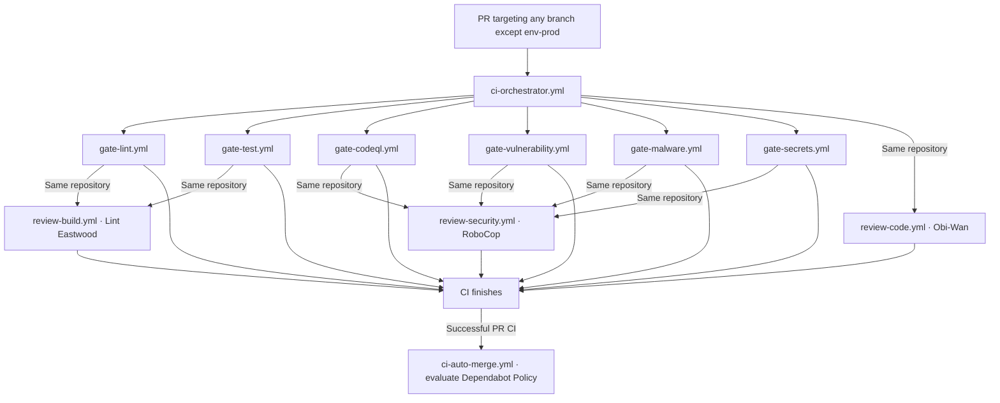
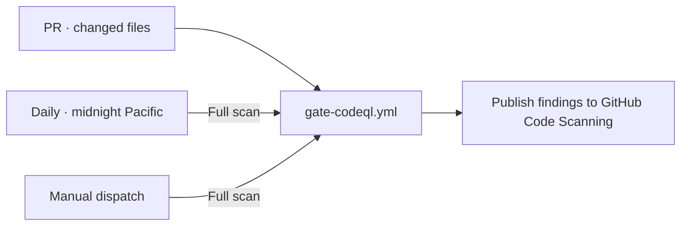
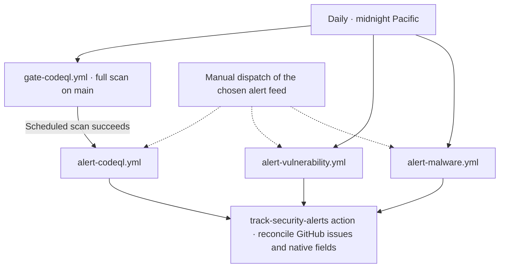
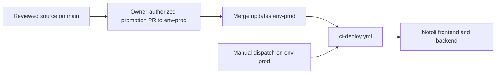

# 🔄 GitHub workflows

Start with [ci-orchestrator.yml](ci-orchestrator.yml) for a pull request. The other entry points are the daily CodeQL scan, the alert trackers, the Dependabot follow-up and the app deployment.

## 🧭 Structure

| File | When it runs | What to look for |
| --- | --- | --- |
| [ci-orchestrator.yml](ci-orchestrator.yml) | PR opened, updated, reopened or marked ready against any branch except `env-prod` | Starts the independent gates and the eligible reviewers. A newer run for the PR supersedes the previous run. |
| [gate-lint.yml](gate-lint.yml) | Called by PR CI | Selects frontend Prettier/ESLint and backend Ruff checks by changed paths. Only eligible same-repository human PRs can receive lint fixes. |
| [gate-test.yml](gate-test.yml) | Called by PR CI | Selects frontend tests and build, Django and MCP tests, automation checks and development-image builds by changed files. |
| [gate-codeql.yml](gate-codeql.yml) | Called by PR CI, daily at midnight Pacific, or manually | Scans the selected Python, JavaScript/TypeScript and Actions configurations on PRs. Scheduled and manual runs select all three. |
| [gate-vulnerability.yml](gate-vulnerability.yml) | Called by PR CI | GitHub Dependency Review checks dependency changes and fails on high or critical advisories. Its native check has the findings. RoboCop gets a bounded 16 KiB summary. |
| [gate-malware.yml](gate-malware.yml) | Called by PR CI | Checks changed public npm and PyPI package versions against published malware advisories. The scanner runs from the PR’s trusted base and reads the proposed Git objects as data. Older bases use their original npm scanner with its pinned semver dependency to check both frontend and automation lockfiles. |
| [gate-secrets.yml](gate-secrets.yml) | Called by PR CI | Gitleaks checks the PR for exposed credentials using a checkout with full history. The result is an independent check. |
| [review-code.yml](review-code.yml) | Same-repository PR, including Dependabot | Obi-Wan reviews the source diff and prior discussion. A major Dependabot update also needs a complete upstream evidence brief. |
| [review-build.yml](review-build.yml) | Same-repository PR, after lint and tests finish | Lint Eastwood reviews build and test results with their bounded diagnostics, including failures. |
| [review-security.yml](review-security.yml) | Same-repository PR, after the security gates finish | RoboCop reviews dependency and secret findings, CodeQL scope, analyzer results and default-branch baselines. |
| [ci-auto-merge.yml](ci-auto-merge.yml) | Successful PR CI completes | Code from `main` validates the exact PR head, records Dependabot Policy and may enable native auto-merge for an eligible dependency update. |
| [alert-vulnerability.yml](alert-vulnerability.yml) | Daily at midnight Pacific or manually | Reconciles open Dependabot vulnerability alerts with repository issues. |
| [alert-malware.yml](alert-malware.yml) | Daily at midnight Pacific or manually | Classifies advisories referenced by this repo’s open Dependabot alerts and tracks malware findings. |
| [alert-codeql.yml](alert-codeql.yml) | After a successful scheduled CodeQL scan on `main`, or manually | Reads the published Code Scanning alerts and reconciles their tracking issues. |
| [ci-deploy.yml](ci-deploy.yml) | Push to `env-prod` or manual dispatch on that branch | Builds immutable app images and deploys the pinned release bundle for this app. |

## Reading and changing the automation

- **Workflow YAML** declares triggers, permissions, jobs, conditions and short step commands. Keep standalone JavaScript programs in [scripts](../scripts) with lower-case, hyphenated names starting with a verb. Use `setup` for actions that configure the runner, `get` to fetch data, `write` for files and workflow outputs, and `evaluate` for interpreting results. Keep visible credential boundaries in the calling step.
- **Reusable steps** live in [actions](../actions/README.md). Each action has one directory, an `action.yml` interface and any implementation files beside it.
- **Tests** live in [.github/tests](../tests). The automation runner discovers top-level suites. Group each script or action’s tests in `<implementation-name>.test.js`. Tests for logic defined directly in workflow YAML take the workflow’s name. A test may exercise other components through its primary entry point. [Fixtures](../fixtures) holds sample inputs and expected outputs.
- **Enforcement** runs in the PR test gate when GitHub automation changes. [validate-workflows.js](../scripts/validate-workflows.js) checks layout, local action reachability, workflow script references, pins and explicit permissions. Proposed write permissions are compared with the same workflow and job in the trusted base commit. The app deployment workflow is generated from the Infrastructure release source. Change the source and update the pinned consumer through the release process.

### Main branch required checks

Frontend jobs read their Node range from `frontend/package.json`. The automation test job reads its range from `.github/package.json`. The app publishes the named lint, test, CodeQL, dependency, secret and reviewer checks. `Auto Merge` is the existing CI job that checks access to branch rules and GitHub’s expected-head API. The separate `Dependabot Policy` follow-up owns auto-merge eligibility. For the configured required contexts and the read-only audit, see the repository’s [branch protection guide](../_README.md#-branch-protection). A failed path detector cannot excuse a skipped suite. Fork PRs run the independent gates without reviewer credentials. Applicable same-repository reviewers need a usable current-head verdict.

| Gate | Required contexts |
| --- | --- |
| Lint | `Lints / Detect Changes`, `Lints / Lint Frontend (ESLint + Prettier)`, `Lints / Lint Backend (Ruff)`, `Lints / Lint Results` |
| Tests | `Tests / Detect Changes`, `Tests / Frontend Tests (React)`, `Tests / Backend Tests (Django)`, `Tests / Test Results` |
| CodeQL | `CodeQL / Detect CodeQL Scope`, `CodeQL / Analyze Python`, `CodeQL / Analyze JavaScript/TypeScript`, `CodeQL / Analyze GitHub Actions` |
| Dependencies | `Vulnerability / Vulnerability`, `Malware / Malware` |
| AI reviewers | `AI Code Review / Obi-Wan Code-nobi code review`, `AI Build Sheriff Review / Lint Eastwood build sheriff review`, `AI Security Review / RoboCop security review` |

The read-only verifier accepts a ruleset and a current-head check-run response saved from GitHub. It verifies required evidence, including successful reviewers. Run `node .github/scripts/validate-reviewer-gates.js <ruleset.json> <check-runs.json>`. Do not count a skipped, neutral or cancelled applicable reviewer as an approval.

### Protected Dependabot auto-merge

The policy uses the changed paths returned by GitHub. An empty list selects no file-specific checks. Fetch errors propagate, and the policy still requires the independent gates and current-head reviewer approvals.

The follow-up resolves the successful CI run to its open PR into `main`. It reads reviewed code from `main`, the proposed commit as data, the required status checks and the three reviewers’ current-head approvals. Signed patch/minor metadata can qualify for native auto-merge with `expectedHeadOid`. Major updates and SHA-only Action changes without a verified update type need owner review. An open alert on an updated package blocks automatic eligibility if its CVSS score exceeds 6.9 or is missing or invalid. Production promotion has separate owner authorization. [Repository configuration](../_README.md)

### Security-alert configuration contract

The daily schedules use `America/Los_Angeles` and follow daylight-saving time. Each feed also accepts manual dispatch. The three callers resolve the `AI_REVIEW_*` variables and pass them into the shared action. RoboCop’s App token reads the feed and writes its issues and native fields. The action validates credentials and the issue schema before reading alerts or updating issues.

RoboCop matches tickets by the feed marker and source alert references in the issue body. It leaves issue labels alone. New tickets use the Bug type and native Priority and Size fields. GitHub handles native status transitions when tickets open or close.

A grouped ticket records each source alert once. RoboCop preserves an existing Domain. For a missing Domain, the area with the most recognized alert paths wins. Ties use the highest severity, then dependency ecosystem or manifest hints. When CodeQL supplies a rule level, RoboCop ranks error alongside high, warning alongside medium, and note alongside low for domain selection. With equally strong or missing evidence, application repositories prefer Backend, Frontend, then Cloud. Infrastructure prefers Cloud, Backend, then Frontend. High alerts raise a group to P1 and critical alerts to P0. Unknown severity also warrants P1. Existing higher priorities and other planning fields are preserved. If synchronization fails partway, rerun the same feed. The action reads saved issue metadata and saves the lifecycle note before closing the issue. GitHub records the completion time. [Alert implementation](../actions/track-security-alerts/action.yml) · [Native issue setup and credentials](../_README.md)

## 🗺️ Architecture and trust boundaries

### Pull request



### CodeQL analysis



### Daily alert tracking



### Production deployment



[Application release configuration and verification](../../deploy/production/README.md)

## 🧪 Checks and diagnostics

Run from the repository root with Git, Bash, Node and the locked Python environment. The full app validator also needs Docker Compose and PowerShell. The lint workflow installs the pinned Actionlint release and verifies its checksum.

```sh
npm ci --prefix .github --ignore-scripts --no-audit --no-fund
node .github/scripts/run-automation-tests.js
node .github/scripts/validate-workflows.js --audit
node .github/scripts/validate-workflows.js --check-codeql-pins
node .github/scripts/validate-repository.js
python deploy/production/build_bundle.py --check-parity
actionlint -ignore 'unknown permission scope "vulnerability-alerts"'
```

The application gate also runs Vitest with two workers before the frontend build, both Django/MCP profiles when selected, and the relevant image builds. Frontend and backend suites continue to report independently. The automation runner discovers top-level JavaScript tests and returns Node’s test exit code. Gate jobs keep the command’s exit status when writing bounded diagnostics for Lint Eastwood.

## 🧪 Coverage boundaries

CodeQL queries the configured languages. Dependency Review and malware advisories cover known published findings. The app malware gate covers public npm and PyPI versions represented by its frontend, backend and automation lockfiles. Private sources, arbitrary container contents and previously unknown malware are outside that advisory check. Gitleaks checks for potential credentials. Local tests use synthetic responses and disposable data. GitHub runner permissions, credential access and production health require separate live evidence.
