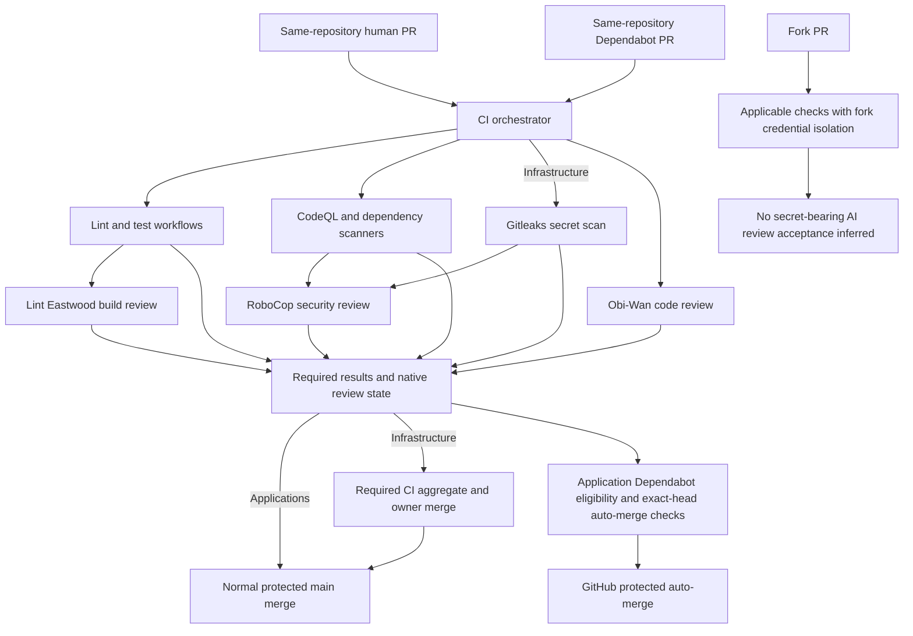
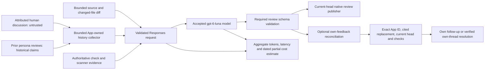
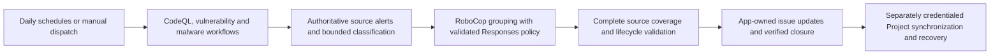
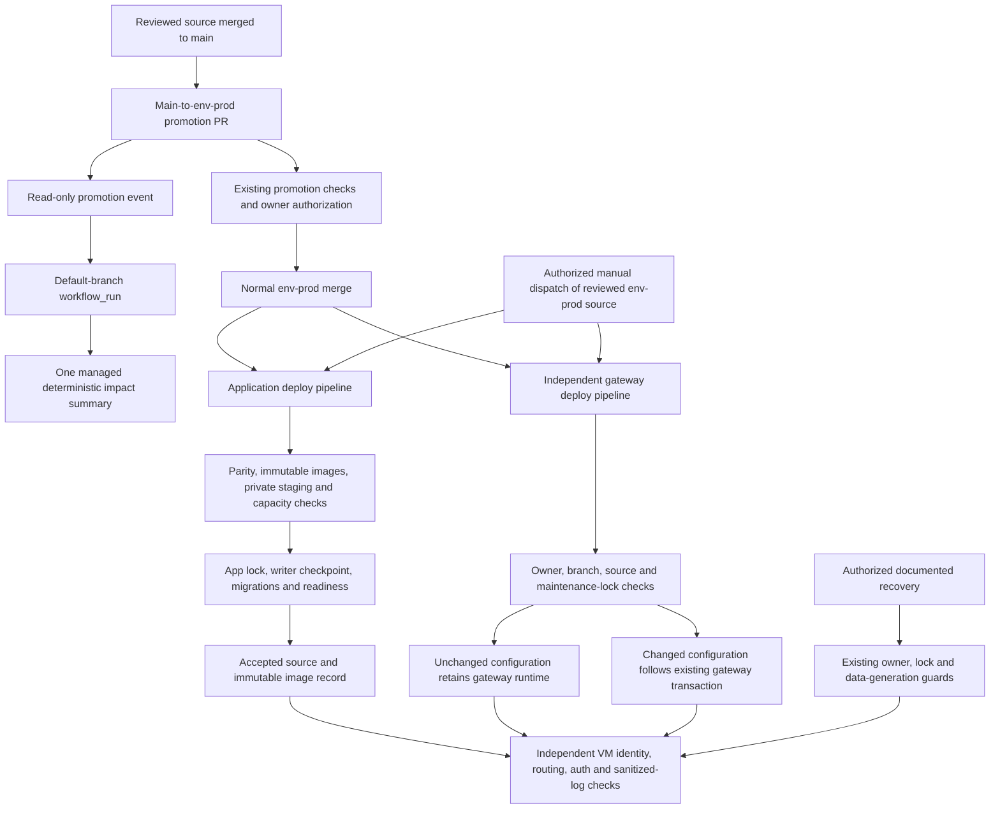

# 🔄 GitHub workflows

CI, reviews, dependency/security checks, and release behavior for Notoli.

## 🧭 Workflow map

| Area | Entry points |
| --- | --- |
| Pull requests | [CI orchestrator](ci-orchestrator.yml), independent gates, and the three reviewer workflows. |
| Security alerts | [CodeQL](alert-codeql.yml), [vulnerability](alert-vulnerability.yml), and [malware](alert-malware.yml) schedules/manual dispatches. |
| Promotion evidence | [Read-only request](promotion-summary-request.yml) and [trusted summary](promotion-summary.yml). |
| Releases | [Release workflow](ci-deploy.yml). |

Workflow YAML is authoritative for triggers, permissions and job dependencies.
Read [repository setup](../README.md) before expecting secret-dependent workflows
to succeed. Commands in this guide run from the repository root.

## 🔄 Pull requests and reviews

### Major-upgrade review evidence

Obi-Wan uses Dependabot's per-dependency metadata for grouped upgrades.
Release lookups use each major update's own ecosystem and target version.
Repository usage searches cover every listed dependency and retain the
tracked-file exclusions and 30,000-byte limit. Numeric Actions references
such as 7 and v7 can match a full release tag such as v7.0.0. Opaque refs
leave a visible evidence gap. Required briefs need at least one valid HTTP(S)
source URL. The publisher keeps independent body findings when it suppresses
duplicate inline comments or sees an unchanged verdict.

<a id="-flow-1-ci-githubworkflowsci-orchestratoryml"></a>

### Flow 1: CI (`.github/workflows/ci-orchestrator.yml`)

Trigger:

- Pull requests (opened/synchronize/reopened/ready_for_review)

What it does:

- Runs the reusable lint gate: [`.github/workflows/gate-lint.yml`](gate-lint.yml)
  - Frontend: Prettier + ESLint (auto-fix, then strict checks)
  - Backend: Ruff (auto-fix, then strict checks)
  - Auto-fix jobs check out code without persisted Git credentials while package installation and lint commands run.
  - Auto-fix commits create the Lint Eastwood GitHub App installation token only after changed files are detected, then use that token to push branch updates.
  - Auto-fix commits resolve Lint Eastwood's bot noreply email at runtime from the app slug and bot user ID, then use `Lint Eastwood <bot-id+lint-eastwood[bot]@users.noreply.github.com>` as both the author and committer identity.
  - The shared [`.github/actions/prepare-lint-commit`](../actions/prepare-lint-commit/action.yml) action validates that identity, configures the token only as the Git remote's push URL, and the lint job restores the unauthenticated push URL immediately after the commit step.
  - Auto-fix is enabled only for non-Dependabot pull requests whose head branch belongs to this repository. Those jobs explicitly check out the writable head branch. Fork and Dependabot pull requests use GitHub's standard pull-request checkout, skip mutating lint steps, and still run strict formatting/lint checks against the submitted code. The lint workflow does not receive an App secret from forks; Dependabot review credentials are handled separately below.
- Runs the reusable test gate: [`.github/workflows/gate-test.yml`](gate-test.yml)
  - Frontend: Vitest via `npm test` (CI mode), then `npm run build` (strict ESLint 10 and Vite production build). Build failures fail the existing frontend test gate and remain in its captured diagnostics.
  - Backend: `python manage.py test`
  - Repository automation: Node's built-in test runner executes colocated behavioral tests for upstream major-upgrade evidence, the AI review publisher, the security-alert reconciler, and large dependency-review report transport. Changes to the report helper or vulnerability workflow also select this test job.
- Lint and test jobs use the same change filters:
  - Frontend checks run for `frontend/**` changes.
  - Backend checks run for `backend/**` changes.
  - Changes to `.github/actions/read-versions/**` or `.github/actions/prepare-lint-commit/**` run both frontend and backend checks because those actions are shared by both lint jobs.
  - Changes to the AI review publisher, prior-review and upstream-evidence collectors, OpenAI/diff actions, CI orchestrator, persona review workflows, repository automation test workflow, or security-alert reconciler run the dedicated repository automation test job without coupling GitHub Action behavior to the frontend unit suite.
  - Other workflow/action changes are validated by Actionlint and CodeQL Actions analysis without forcing application test suites to run.
  - Jobs skipped because their paths are not relevant report `not-applicable` to downstream review workflows.
  - Lint, test, and CodeQL change detection uses the pinned `dorny/paths-filter` action. If its GitHub API request fails, the detector remains failed but adds a titled error annotation and workflow summary explaining that no scope was evaluated and the workflow should be rerun.
- Runs the reusable CodeQL gate: [`.github/workflows/gate-codeql.yml`](gate-codeql.yml)
  - Python/Django backend analysis for `backend/**`
  - JavaScript/TypeScript frontend analysis for `frontend/**`
  - GitHub Actions workflow analysis for `.github/workflows/**` and `.github/actions/**`
- Runs the reusable vulnerability gate: [`.github/workflows/gate-vulnerability.yml`](gate-vulnerability.yml)
  - Uses GitHub Dependency Review and fails when a PR introduces a high or critical vulnerability.
  - Emits a bounded vulnerability report output for RoboCop instead of posting a standalone PR comment. Full dependency and vulnerability JSON travels through a file and is retained in the `dependency-review-evidence` artifact; it is not passed through a large environment variable. The report includes change counts, vulnerable entries up to 16 KiB, and an explicit omitted-entry count. Every non-success Dependency Review outcome fails the gate, independently of report size.
- Runs the reusable malware gate: [`.github/workflows/gate-malware.yml`](gate-malware.yml)
  - Uses the local [npm malware review action](../actions/review-npm-malware/action.yml) to compare changed `frontend/package-lock.json` packages against GitHub's npm malware advisories. Queries use GitHub's documented [affects filter](https://docs.github.com/en/rest/security-advisories/global-advisories#list-global-security-advisories) with one unique changed package name per query, following every result page and matching versions locally; API failures still block the gate. This avoids downloading the full global malware corpus for each dependency PR.
  - Follows GitHub's cursor-based advisory pagination and applies a per-request timeout so the gate terminates reliably as the advisory feed grows.
  - Emits a malware report output for RoboCop and fails when a changed package/version matches a known malware advisory.
- For trusted same-repository PRs, including Dependabot, runs [`.github/workflows/review-code.yml`](review-code.yml)
  - Runs Obi-Wan Code-nobi, the AI Code Reviewer, for general implementation review
  - Reviews the repository file map, changed-file contents, prior Obi-Wan Code-nobi reviews on the PR, and line-numbered PR diff, then publishes one native PR review with inline comments when line placement is valid.
- For trusted same-repository PRs, including Dependabot, runs [`.github/workflows/review-build.yml`](review-build.yml) after frontend/backend lint and tests complete.
  - Runs Lint Eastwood, the AI Build Sheriff, to interpret lint, test, build, formatting, and CI evidence.
  - Consumes lint/test statuses, log tails, prior Lint Eastwood reviews on the PR, and the line-numbered PR diff before publishing one native PR review.
  - Requests changes when failed lint/test/build evidence appears caused by the PR; approves clean build evidence.
- For trusted same-repository PRs, including Dependabot, runs [`.github/workflows/review-security.yml`](review-security.yml) after the security checks.
  - Runs RoboCop, the AI Security Officer, after CodeQL, Dependency/Vulnerability Review, and Malware Review complete.
  - Consumes explicit gate results, vulnerability/malware reports, security check summaries, check annotations, prior RoboCop reviews on the PR, and the line-numbered PR diff before publishing one native PR review.
  - Requests changes for actionable security findings; approves clean security evidence.
  - Dependency Review, malware scanning, and CodeQL remain independent required checks; RoboCop does not replace them.
- All three AI persona workflows run for trusted same-repository pull requests, including Dependabot. Fork PRs remain excluded from secret-dependent reviews and rely on the independent lint, test, CodeQL, vulnerability, and malware gates. Dependabot lint auto-fixes remain disabled; eligible patch/minor updates use the per-head protected policy described below.

#### Dependabot major upgrade briefs

For `version-update:semver-major` updates, Obi-Wan publishes a **Major upgrade brief** in its native review, matching MacroMapper's format. The brief identifies the dependency and version transition, explains the upstream breaking change and material gains, cites exact Notoli paths affected, gives a merge/hold/migration recommendation, and links the primary sources used. It does not add a standalone comment or a new required check, and major updates remain excluded from automatic merging.

The workflow uses pinned Dependabot metadata, the target and first release in the new major line from GitHub Releases, npm/PyPI repository metadata, the bounded Dependabot PR description, a bounded exact-match search of tracked repository text, and [Responses API web search](https://developers.openai.com/api/docs/guides/tools-web-search). Search runs only for semver-major code reviews; other reviews have no web tool. Missing releases, unsupported ecosystems such as Docker, registry and API failures are recorded as evidence gaps so the reviewer can search official sources and explain uncertainty rather than invent release rationale.

Upstream release notes are capped at 12,000 characters per release, repository usage evidence at 30,000 bytes, and the PR description at 12,000 characters. The shared diff action follows MacroMapper's 2 MB (2,000,000-byte) budget and excludes generated npm, Yarn, pnpm, and Poetry lockfiles from the diff for all three reviewers; Obi-Wan's separately bounded changed-file context retains MacroMapper's behavior. Each persona publishes an incomplete-review `COMMENT` and fails its check when the source diff is truncated, withholding the normal model call and verdict. This also ports the complete-diff behavior tracked in [#660](https://github.com/VanillaIceCube/Notoli/issues/660).

The publisher requires all major-brief fields before publishing a normal major-upgrade review. An incomplete brief produces one unavailable notice per persona/commit and fails the review job. An unchanged verdict retains its brief rather than collapsing to a summary. A native `REQUEST_CHANGES` review fails the corresponding reviewer check, matching MacroMapper. OpenAI requests cap combined reasoning and visible output at 16,000 tokens; invalid credentials, quota errors, and unusable model responses retain the existing visible failure behavior.

The port uses MacroMapper main `9075aab874ea92dbac1656458b893a3221a6ca07` as its reference. A shared dependency-usage loop bug omits the final dependency (and all usage evidence for a single-package update); its coordinated fix and behavioral coverage are tracked in [Notoli #890](https://github.com/VanillaIceCube/Notoli/issues/890), [MacroMapper #230](https://github.com/VanillaIceCube/MacroMapper/issues/230), and [FullStackTemplate #195](https://github.com/VanillaIceCube/FullStackTemplate/issues/195). This parity port does not introduce a separate Notoli-only fix. Additional verified shared issues are tracked in #891 (suppressed inline duplicates can hide independent body findings), #892 (grouped versions and bare Actions release references), and #893 (invalid source values can satisfy the required-brief check). Matching tickets exist in MacroMapper and FullStackTemplate; the PR links each coordinated set.

OpenAI and GitHub App inputs:

- `OBI_WAN_OPENAI_API_KEY`, `LINT_EASTWOOD_OPENAI_API_KEY`, and `ROBOCOP_OPENAI_API_KEY` secrets. Triggered AI reviews fail visibly when the key is missing or the OpenAI request cannot produce a usable response.
- `OPENAI_REVIEWERS_PROJECT_ID` (repo variable)
- Configure `OBI_WAN_OPENAI_API_KEY`, `LINT_EASTWOOD_OPENAI_API_KEY`, `ROBOCOP_OPENAI_API_KEY`, `OBI_WAN_CODE_NOBI_PRIVATE_KEY`, `LINT_EASTWOOD_PRIVATE_KEY`, and `ROBOCOP_PRIVATE_KEY` in both the Actions and Dependabot secret stores. Dependabot-triggered workflows use Dependabot secrets; repository variables supply the same App IDs and OpenAI project ID. Missing/invalid review credentials fail visibly rather than falling back to another author or granting an approval. Fork PRs receive neither secret store through these reviewer jobs.
- `OBI_WAN_CODE_NOBI_APP_ID` repository variable and `OBI_WAN_CODE_NOBI_PRIVATE_KEY` repository secret authenticate the Obi-Wan Code-nobi GitHub App. Install it with `Contents: read` and `Pull requests: write`.
- `LINT_EASTWOOD_APP_ID` repository variable and `LINT_EASTWOOD_PRIVATE_KEY` repository secret authenticate the Lint Eastwood GitHub App. Install it on this repository with `Contents: write` so lint auto-fix commits can be pushed, and `Pull requests: write` so build reviews can be published. The CI orchestrator passes only `LINT_EASTWOOD_PRIVATE_KEY` into the reusable lint workflow. The secret is optional so untrusted/fork and Dependabot pull requests can take the strict-check-only path; when auto-fix is enabled, a missing secret, invalid app identity, or insufficient app permission fails the auto-fix job instead of falling back to `GITHUB_TOKEN` attribution.
- `ROBOCOP_APP_ID` repository variable and `ROBOCOP_PRIVATE_KEY` repository secret authenticate the RoboCop GitHub App. Install it with `Contents: read`, `Pull requests: write`, `Checks: read`, `Actions: read`, `Code scanning alerts: read`, `Dependabot alerts: read`, and `Issues: write`. The CodeQL alert workflow narrows its short-lived installation token to `Code scanning alerts: read` and `Issues: write`; the vulnerability and malware workflows additionally request `Dependabot alerts: read` through the token action's `vulnerability-alerts` input. The other permissions remain available only to RoboCop's PR-review workflow.
- AI reviews use `gpt-6-luna` through the local OpenAI Responses API action.
- AI personas do not post standalone PR comments. Any bot comments are submitted as part of their native PR review.
- If OpenAI quota or tokens are exhausted, credentials are invalid, the service is unavailable, or the model response is unusable, the affected persona publishes one native `COMMENT` review per commit explaining that no AI approval or finding was produced. The workflow remains failed until it can be rerun successfully; independent lint, test, CodeQL, vulnerability, and malware gates remain authoritative.
- AI personas return one shared structured contract: native review event, characterful summary, unchanged status, body findings, material evidence, author actions, and inline comments. The model authors the complete verdict prose, while the shared publisher owns canonical GitHub Markdown, renders every visible identity or group label as an underlined `##` heading, and omits empty groups.
- Each review keeps a recognizable emoji-led identity and persona-specific group labels: Obi-Wan Code-nobi uses `🧭` with `🔎 Findings`, `📚 Evidence reviewed`, and `✅ Next step`; Lint Eastwood uses `🤠` with `🔧 Build findings`, `🧾 Check evidence`, and `🛠️ Fix`; RoboCop uses `🛡️` with `⚠️ Security findings`, `📋 Evidence`, and `▶️ Directive`. Prompt-guided summaries give Obi-Wan and Lint Eastwood a natural, lightly characterful voice without forced metaphors, while RoboCop keeps the bolder enforcement-terminal framing, controlled all-caps, and playful directives. Technical findings and inline comments stay concise, professional, and evidence-backed.
- AI personas read prior native reviews authored by their own GitHub App identity and suppress duplicate inline findings when the evidence has not changed. Unchanged reviews retain their native event, use a fresh persona-specific summary, and omit repeated findings, evidence, and actions.
- AI review publishing only sends inline comments that target valid added diff lines. Every finding that cannot be placed inline is preserved under the normal Findings group with file and line context; duplicate, placement, and malformed-comment diagnostics are recorded in workflow logs instead of visible automation notes. The publishing logic, visual Markdown examples, and Node regression tests are colocated under `.github/actions/publish-ai-review/`.

Review personas:

- **RoboCop - AI Security Officer:** owns CodeQL, Dependency/Vulnerability Review, Malware Review, security-sensitive code paths, permissions/auth risk, and security interpretation.
- **Lint Eastwood - AI Build Sheriff:** owns lint failures, test failures, build/workflow failures, formatting/type-check style failures, and CI failure interpretation.
- **Obi-Wan Code-nobi - AI Code Reviewer:** owns general implementation review: correctness, maintainability, architecture, edge cases, missing tests, API/UX concerns, and overall code quality.

Security-alert aggregation:

- Daily workflows collect open CodeQL alerts plus non-urgent Dependabot vulnerability alerts and npm malware-classified Dependabot alerts. Each workflow also supports **Run workflow** from the Actions tab.
- The alert workflows keep scheduling in [`alert-codeql.yml`](alert-codeql.yml), [`alert-vulnerability.yml`](alert-vulnerability.yml), and [`alert-malware.yml`](alert-malware.yml). The fetching, grouping, validation, and synchronization implementation lives in the [Security Alerts composite action](../actions/security-alerts/action.yml). The response must be valid JSON and must account for every source alert exactly once; validation happens before any issue is created or updated.
- OpenAI request failures, including exhausted quota/tokens, missing credentials, transport errors, and unusable responses, produce a warning and workflow summary with recovery guidance. Alert synchronization then fails validation before changing tickets.
- Generated issues contain a stable marker derived from their feed and source-alert references. Reconciliation also parses the underlying references from every open workflow-managed issue, so changing AI prose or group order updates the same tickets and split or merged groups reuse a deterministic overlapping canonical ticket instead of creating overlapping coverage.
- Every current source alert appears in exactly one open managed issue. Reused issues retain their existing GitHub Project fields, labels, and assignees while the workflow ensures the repository owner and the correct gray feed tag (`codeql`, `vulnerability`, or `malware`) remain present. New issues, and existing issues newly added to the Project, receive the documented default fields.
- Superseded managed issues are closed as completed after all of their still-open source alerts move to current canonical tickets. Resolved or no-longer-eligible alerts are removed when a canonical issue is refreshed; a managed issue with no current coverage is closed even when the feed has zero alerts. Closed bodies retain their source-alert links and gain a lifecycle note pointing to replacement tickets when applicable. Their Project status moves to `Done`, with `End date` recorded when that field exists.
- Required repository configuration: `ROBOCOP_OPENAI_API_KEY`, `ROBOCOP_PRIVATE_KEY`, and `SECURITY_ALERTS_TOKEN` secrets; `ROBOCOP_APP_ID`, `OPENAI_REVIEWERS_PROJECT_ID`, and `SECURITY_ALERTS_PROJECT_ID` repository variables; and a RoboCop installation on Notoli. `SECURITY_ALERTS_PROJECT_ID` is the node ID of the personal Notoli GitHub Project v2.
- RoboCop must have `Issues: write` for issue creation, edits, labels, assignment, comments, and closure; `Code scanning alerts: read` (the `security-events` workflow input) for CodeQL reads; and `Dependabot alerts: read` (the token action's `vulnerability-alerts` input) for vulnerability and malware reads. After changing the App registration, approve the requested permission update on the existing installation. Each workflow explicitly narrows the one-hour installation token to the permissions its feed needs and to the Notoli repository.
- `SECURITY_ALERTS_TOKEN` remains separate because the Notoli board is a personal Project v2. It is passed only to the Project GraphQL client and needs `project` access plus whatever repository visibility GitHub requires for the Project's issue content. It is no longer used to read security alerts or mutate issues.
- The project must include these fields and options: `Status` → `Backlog`, `Domain` → `CI/CD`, `Type` → `Security`, `Priority` → `P1`/`P2`, `Size` → `M`, and numeric `Estimate` (set to `3`). CodeQL and malware groups use `P1`; non-urgent vulnerability groups use `P2`. The workflows require and write all of them.
- `GITHUB_TOKEN` is limited to `contents: read` for checkout and is not persisted in the Git remote. RoboCop performs all alert reads and issue operations. `SECURITY_ALERTS_TOKEN` performs only Project v2 reads and writes; the shared action rejects empty credentials or a shared RoboCop/Project credential instead of falling back to `GITHUB_TOKEN` or the personal token for issue authoring.
- Missing or invalid RoboCop App IDs, private keys, installations, or requested permissions fail during installation-token creation. The shared action also emits an actionable error for missing tokens, a missing Project ID, or credential reuse before fetching alerts or changing tickets.
- A safe attribution check is to run one alert workflow manually against current alerts after approving the App permission update. Reference-based reconciliation reuses current managed tickets, so the run exercises RoboCop-authored edits without creating duplicate production tickets. Confirm the workflow actor in an edited ticket's history and verify Project synchronization remains successful.
- Run the repository automation coverage locally with `node --test .github/actions/collect-upstream-major-upgrade-evidence/collect-upstream-major-upgrade-evidence.test.js .github/actions/publish-ai-review/publish-ai-review.test.js .github/actions/security-alerts/sync-security-alerts.test.js`. Major-upgrade coverage exercises npm, PyPI, and GitHub Actions sources, target/first-major releases, release-note bounds, lookup failures, complete/incomplete briefs, preservation on unchanged reviews, blocking review checks, the shared diff budget and incomplete-review wiring, bounded OpenAI request configuration, and major-only evidence/web-search wiring. Workflow coverage follows MacroMapper's tests; the dependency-usage loop regression is tracked separately in #890. AI review coverage includes persona-specific clean approvals, populated semantic groups, infrastructure-only comments, exact-line comments, unchanged reviews, duplicate suppression, preservation of multiple unplaceable findings, malformed-response diagnostics, unavailable notices, and synchronization of the rendered [`review-output-examples.md`](../actions/publish-ai-review/review-output-examples.md) fixture. Security-alert coverage includes credential separation and RoboCop-only issue mutations; reconciliation across unchanged and reordered groups, splits, merges, added alerts, resolved alerts, empty feeds; and the known stale-ticket set from issue #633.

Version pins:

- Node version is read from `frontend/package.json` (`engines.node`)
- Python requirements are read from `project.requires-python` in `backend/pyproject.toml`; uv synchronizes `backend/uv.lock` against that project definition.
- `.github/actions/setup-uv` installs uv 0.13.8, runs `uv sync --locked`, and exposes the project environment to Python subprocesses. Lint and parser-only jobs install only the `dev` group; the privileged policy workflow retains reviewed-main checkout and uses no dependency cache.
- Third-party `dorny/paths-filter` workflow steps are pinned to an immutable commit hash.

CodeQL details:

- Pull requests run CodeQL through `ci-orchestrator.yml`, keeping PR feedback under the main CI workflow.
- Pull request CodeQL uses the reusable workflow's change-detection job, following the same skip-by-scope pattern as linting and testing; documentation-only and unrelated pull requests run the detector but skip analysis jobs.
- For a CodeQL-relevant pull request, Python and JavaScript/TypeScript analysis use language-specific filters, while GitHub Actions analysis runs so the `/language:actions` configuration remains present for code-scanning comparisons.
- CI ignores pull requests targeting `env-prod`, so CodeQL is not invoked for that deployment branch.
- Pushes to `main`, weekly scheduled scans, and manual `workflow_dispatch` runs are supported directly by `gate-codeql.yml`.
- CodeQL uploads SARIF results to GitHub Code Scanning with scoped permissions: `contents: read`, `pull-requests: read`, `actions: read`, and `security-events: write`.
- Results appear in PR checks and under GitHub Security -> Code scanning when code scanning is enabled for the repository.
- CodeQL uses the `security-extended` and `security-and-quality` query suites for Python, JavaScript/TypeScript, and GitHub Actions workflow analysis.
- CodeQL is not a scanner for Dockerfiles, Nginx config, or env example files. Those remain covered by Dependabot updates, review, and deployment validation unless a separate scanner is added.

Merge blocking:

- The active `main` ruleset requires the exact checks listed below, including CodeQL scope detection, the three analyzers, Vulnerability, and Malware.
- Dependency vulnerability review fails at `high` severity or above and posts its summary directly on the PR.
- Dependency malware review is npm-focused because GitHub's malware advisory coverage is currently npm-focused; it checks only changed lockfile package versions.
- The workflow reports CodeQL findings, and CodeQL must pass before `ci-auto-merge.yml` can run.
- Dependabot auto-merge requires lint, test, CodeQL, vulnerability, and malware checks to pass.
- To make serious CodeQL findings block merges, configure GitHub branch protection or a repository ruleset to require the relevant CodeQL check after validating runtime and alert noise.
- Recommended staged policy: block high/critical security findings first; allow medium, low, and note-level findings to report until the false-positive rate is understood.
- When code fixes remove a finding, GitHub closes the matching code scanning alert after the protected branch is reanalyzed. False positives or accepted risks should be dismissed in GitHub Code Scanning with a clear reason.

#### Main branch required checks

The active [Main Branch Protection ruleset](https://github.com/VanillaIceCube/Notoli/rules/12154610) requires these exact status contexts:

| Gate | Required contexts |
| --- | --- |
| Lint | `Lints / Detect Changes`, `Lints / Lint Frontend (ESLint + Prettier)`, `Lints / Lint Backend (Ruff)`, `Lints / Lint Results` |
| Tests | `Tests / Detect Changes`, `Tests / Frontend Tests (React)`, `Tests / Backend Tests (Django)`, `Tests / Test Results` |
| CodeQL | `CodeQL / Detect CodeQL Scope`, `CodeQL / Analyze Python`, `CodeQL / Analyze JavaScript/TypeScript`, `CodeQL / Analyze GitHub Actions` |
| Dependencies | `Vulnerability / Vulnerability`, `Malware / Malware` |
| AI reviewers | `AI Code Review / Obi-Wan Code-nobi code review`, `AI Build Sheriff Review / Lint Eastwood build sheriff review`, `AI Security Review / RoboCop security review` |

The standalone `CodeQL` Code Scanning results context is intentionally excluded. Historically it was required alongside the four explicit workflow jobs, but GitHub only emits it when analysis uploads results. A documentation-only PR such as [#844](https://github.com/VanillaIceCube/Notoli/pull/844) passes scope detection and skips all analyzers, leaving that standalone requirement pending forever. This policy matches the scope-aware configuration used by MacroMapper and FullStackTemplate.

GitHub accepts skipped analyzer jobs as satisfying required checks. Scope-detection failures and failed in-scope analyzers remain merge blockers. Findings remain visible in Code Scanning and PR results when analysis runs; severity-based blocking is a separate Code Scanning policy, as described above. Removing the standalone context does not introduce a new findings-severity gate.

When editing or recreating the ruleset, retain all 17 contexts above and exclude the standalone `CodeQL` context. Preserve the remaining ruleset settings, conditions, and bypass actors. Validate the live context list with `gh api repos/VanillaIceCube/Notoli/rules/branches/main` and inspect `gh pr checks` for both a documentation-only PR and a code-changing PR.

The three reviewer requirements were activated for [#946](https://github.com/VanillaIceCube/Notoli/issues/946) after verifying exact emitted names on human PR #944 and same-repository Dependabot PR #941, the six reviewer secret names in both credential stores, and app/project variable names. [The dated evidence snapshot](../review-gating-evidence.json) records the original and updated rules, successful runs, and PR #942's genuine requested-changes/failing-check followed by approval/passing-check. The existing 14 requirements and all other ruleset settings were preserved.

A published `REQUEST_CHANGES` fails each persona's job, including repeated or unchanged verdicts. Valid `APPROVE` and `COMMENT` succeed; missing credentials, malformed/invalid output, incomplete major briefs and oversized diffs fail visibly. Build/security reviews use `always()` so upstream failures or skipped gates do not suppress them. No reviewer path filters exclude documentation changes. Forks receive no private credentials; review from a trusted same-repository branch is required.

Missing required contexts remain pending; failed or cancelled checks require a successful rerun on the current head. GitHub accepts skipped jobs as satisfying requirements, so a skipped reviewer must never be treated as review evidence. The regression tests preserve reviewer eligibility and the publishing/incomplete-review paths. The read-only audit below rejects missing, skipped, cancelled, neutral and non-success reviewer results; it does not publish an aggregator or change protection.

```powershell
gh api repos/VanillaIceCube/Notoli/rulesets/12154610 > ruleset.json
gh api "repos/VanillaIceCube/Notoli/commits/<HEAD_SHA>/check-runs?per_page=100" > head-check-runs.json
node .github/actions/publish-ai-review/verify-gates.js ruleset.json head-check-runs.json
node --test .github/actions/publish-ai-review/*.test.js
actionlint
```

<a id="-shared-mcp-framework"></a>

### Shared MCP framework

The backend test gate runs the documented ordinary/MCP-enabled profiles. Template sample fixtures do not create a production target; Notoli and MacroMapper retain their app-owned enabled protocol/domain acceptance. See [the framework guide](../../backend/apps/mcp/README.md#framework) and the application MCP guide where present.

## 🔒 Merge and dependency controls

<a id="-flow-3-dependabot-githubdependabotyml--ciauto-merge"></a>

### Flow 3: Dependabot (`.github/dependabot.yml` + CI/Auto Merge)

Dependabot configuration:

- [`.github/dependabot.yml`](../dependabot.yml) opens daily PRs for:
  - npm (`/frontend`)
  - pip (`/backend`)
  - GitHub Actions (`/`)
  - Docker (`/backend/docker`, `/frontend/docker`)

Auto-merge behavior:

- Dependabot PRs go through CI (`ci-orchestrator.yml`), and if all gates pass, `ci-auto-merge.yml` can enable auto-merge.
- Dependabot PRs receive the three required same-repository AI reviews using Dependabot secrets. Major updates additionally receive Obi-Wan's upgrade brief and remain a human merge decision. [#656](https://github.com/VanillaIceCube/Notoli/issues/656) owns the existing Dependabot eligibility implementation; [#946](https://github.com/VanillaIceCube/Notoli/issues/946) adds the missing reviewer requirements. Independent lint, test, CodeQL, vulnerability, and malware gates continue to block auto-merge when any gate fails.
- Auto-merge is restricted to patch/minor updates.
- If a security alert is present, the workflow requires CVSS <= 6.9.
- The workflow uses `dependabot/fetch-metadata@25dd0e34f4fe68f24cc83900b1fe3fe149efef98` (`v3.1.0`) using the follow-up workflow token for metadata/alert lookup.

AI review context includes bounded recent owner/collaborator reviews and replies to prior findings as discussion evidence. Prior bot verdicts must be rechecked against current source/scanners; the diff legend distinguishes active added/context lines from deleted old code. This does not change reviewer verdict rules or authorize merges/deployments.

External GitHub Actions use immutable commit SHAs with version comments.
Keep that convention when updating workflows or composite actions; preserve
review/scanner failure gates and do not treat action updates as deployment approval.

When updating the pinned `actions/create-github-app-token` revision, update the
security-alert workflow assertion in
`.github/actions/security-alerts/sync-security-alerts.test.js` and rerun the
repository automation tests. The current reviewed action revision is
`64ab729a6294000f5aa4a4bc0b73d1f32bc45510` (v3.3.0).

The shared release pin includes template-policy regression coverage coordinated
with [FullStackTemplate #217](https://github.com/VanillaIceCube/FullStackTemplate/issues/217)
and [Infrastructure #26](https://github.com/VanillaIceCube/JudeAndrewAlabaInfrastructure/pull/26).
It derives common preflight fixtures from app policy while retaining this app's
existing trust, networks, environment requirements, workflow and runtime bytes.
The same immutable source commit is proposed for all three consumers. These
source-pin PRs do not authorize merging, promotion, or deployment.

<a id="-protected-dependabot-auto-merge"></a>

### Protected Dependabot auto-merge

FullStackTemplate (#240) owns the canonical application policy. After successful
PR CI, `ci-auto-merge.yml` runs only reviewed main code, with no PR checkout,
artifacts, caches, PAT, reviewer keys or production secrets. The API resolves the
successful CI workflow and its exact open main PR; rerun actor identity is not
used as PR authorship. Forks and non-Dependabot PRs receive a nonblocking policy
result without any automatic merge or secret-dependent review.

Each application main ruleset must require **Dependabot Policy**, pinned to the
GitHub Actions integration (15368). The follow-up creates this check in progress
on the PR head. All other required checks and all three current-head persona
approvals must pass. The check stays pending while native auto-merge is enabled
with `expectedHeadOid`, then succeeds only after validation/activation succeeds.
Failures leave it failing or pending. A later push has no policy result and
cannot inherit the preceding head's approval. This also avoids trying to enable
native auto-merge on an already-clean PR. No direct merge fallback exists.

Automatic eligibility requires exactly one verified Dependabot-authored commit
matching the current head. Explicit update types are parsed from its signed YAML
metadata with pinned PyYAML safe loading, without overriding runner event paths
or trusting PR descriptions. Every grouped member must be patch/minor; missing
metadata fails visibly and major updates stay manual. Before allowing a manual
major update, the policy disables an existing native auto-merge request.

All open Dependabot alerts are paginated with the built-in token's explicit
`vulnerability-alerts: read` permission. Every matching updated dependency must
have a known CVSS score at most 6.9. Dismissed/fixed alerts cannot hide another
open alert, and neither later group members nor alerts beyond the first page are
ignored. The workflow publishes only the policy outcome, not alert details.

The guard reads active branch rules using API 2026-03-10 (Metadata: read), checks
required contexts and integration identities, rejects requested changes and
checks every persona's current-head approval. Scoped CodeQL skips must also
match authoritative API diff paths, including previous paths on renames. Null or
unknown mergeability and propagation of the pending policy check are polled at
most six times with two-second waits; unstable/conflicting states fail closed.
Repeated events are idempotent and genuine API failures remain visible. GitHub
retains final enforcement of review-thread resolution and all branch rules.

Generated repositories that install their own reviewer Apps can set optional
`OBI_WAN_REVIEWER_LOGIN`, `LINT_EASTWOOD_REVIEWER_LOGIN`, and
`ROBOCOP_REVIEWER_LOGIN` repository variables to their actual bot logins, including
`[bot]`. Defaults match the existing shared persona Apps. All three must be
distinct bot identities. Existing per-persona credentials and fork exclusions
remain unchanged. Repository writers who can alter workflows remain privileged;
helper checks do not constrain arbitrary workflow writers.

For activation, merge reviewed source first, then add Dependabot Policy to the
main ruleset without removing any existing requirement or bypass restriction.
The new rule requires a fresh successful CI completion to publish policy evidence;
existing open PRs may need a CI rerun. Do not require the follow-up workflow's
nested job name, which starts only after CI. No production branch is involved.
The first eligible real default-branch Dependabot follow-up remains separate
runtime acceptance in #240; a human implementation PR does not establish it.

CI supplies read-only live branch-rule/schema evidence to Obi-Wan when reviewing
auto-merge/orchestration changes. This confirms actual token access and current
GraphQL input fields without changing reviewer verdict requirements.

## 🛡️ Security and alerts

<a id="-dependency-evidence-and-alert-lifecycle-parity"></a>

### Dependency evidence and alert lifecycle parity

The reusable baseline is FullStackTemplate's `.github/actions/prepare-vulnerability-report`.
MacroMapper, Notoli and Infrastructure carry the same report implementation and
regression contract. Dependency Review still blocks high/critical additions;
every non-success scanner outcome, missing/malformed output or failed evidence
preparation fails the independent Vulnerability check. No empty-array fallback
may turn unavailable evidence into a clean scan. RoboCop receives at most 16 KiB
of package/severity/manifest context, with omitted-entry counts. The
`dependency-review-evidence` artifact retains every structured entry for seven
days, excluding untrusted free text and arbitrary URLs; unavailable evidence is
retained as structured diagnostics. Artifacts have the repository's Actions
access controls, not an additional private storage boundary.

Alert synchronization saves source history/replacement links first, ensures
Project membership, then writes End date before Status Done. Done can trigger
Project auto-close. The issue client re-reads state before a separate state-only
close. Only GitHub's observed HTTP 422 `Validation Failed` with an empty errors
array is eligible for recovery, and only if another read proves closed/completed
with the exact saved lifecycle body. Other failures propagate. Partial Project
failures leave the issue open for rerun; issue mutations remain attributed to
RoboCop and Project writes use the separate Project credential. New items use
the live `Work type` field. No credentials, branch protections or deployments
change.

Historical evidence: FullStackTemplate #192 closed at 2026-10-11 16:40:51 UTC,
before run 38156425534's state-close PATCH returned 422 at 16:40:52 UTC with
`errors: []`. Notoli #825 has the same earlier pattern. All four Projects have
Auto-close issue enabled (read-only verification 2026-10-20). This establishes
the competing-close ordering; GitHub's internal validation cause is not exposed.
Mocks reproduce that interleaving and reject unrelated errors. Empty scheduled
feeds do not establish that a live close race occurred.

CodeQL now forwards `scope_status`, `scope_python`, `scope_javascript` and
`scope_actions` to RoboCop's shared evidence collector. A PR language skip is
expected only with successful, known scope and a completed matching default-
branch baseline. Missing, failed or unavailable evidence stays an explicit gap.
Main pushes and scheduled/manual scans still analyze every language. Existing
check names, categories, queries and ruleset requirements remain unchanged;
this does not independently resolve the historical default-branch/attribution
acceptance in #612 or #587.

<a id="-compatible-codeql-updates"></a>

### Compatible CodeQL updates

Dependabot groups all `github/codeql-action` entry points (including `init`,
`analyze`, `autobuild` and `upload-sarif`) in `codeql` version-update PRs.
A separate `codeql-security` group applies the same matching to security updates;
GitHub does not combine version and security updates in one group. Keep both
patterns (`github/codeql-action` and `github/codeql-action/*`) so repository and
entry-point dependency names match. Review every CodeQL entry point together,
keep their immutable revisions aligned, and preserve normal CI/reviewer gates.

The applications retain daily updates. Infrastructure retains weekly updates,
its owner/labels/PR limits, general Actions group for non-CodeQL updates, and
separate Compose updates. All application CodeQL entry points use the aligned
immutable v4.39.3 revision (`33d7b85da1a04171e211befe2c739303b9a4c066`).
Regenerate `.github/workflows/ci-source-inventory.json` with
`python .github/tools/ci_architecture.py` after workflow pin changes and verify it with
`--check`. Scanner scope, permissions and merge/deployment
gates remain unchanged. Canonical rollout:
[FullStackTemplate #271](https://github.com/VanillaIceCube/FullStackTemplate/issues/271).
The November maintenance sweep tracks the aligned upgrade and generated inventory
in [FullStackTemplate #309](https://github.com/VanillaIceCube/FullStackTemplate/issues/309).

<a id="-atomic-codeql-regression-guard"></a>

### Atomic CodeQL regression guard

Before required scope detection, all CodeQL action entry points in workflow and
composite-action YAML must share one full immutable SHA. Structural safe parsing
covers flow mappings, quoted/escaped keys, folded values, aliases and mixed-case
owner/repository names. Negative regressions reject drift, mutable pins and
missing analysis. The existing version/security update groups and daily cadence
remain unchanged. Infrastructure adopts this guard and reviewer eligibility,
retaining weekly updates, independent Required CI and owner merge.

```sh
uv sync --locked --project backend
# Add backend/.venv/Scripts (Windows) or backend/.venv/bin (Unix) to PATH
# for Node regression tests that spawn Python.
node --test .github/actions/check-codeql-pins/*.test.js .github/actions/dependabot-auto-merge/*.test.js
```

The local actionlint 1.7.12 schema predates GitHub's documented
`vulnerability-alerts: read` scope. Its other diagnostics remain enforced; GitHub
validates the new permission and CI must pass before merge.

The reviewer API evidence step uses direct read-only API calls and executes no
PR-workspace module with its GitHub client.

Every skipped lint, test or analyzer check is now verified against the actual
reviewed detector filters, with original and renamed API diff paths. Unknown
filter forms refuse skip authorization. GitHub Action subpaths also match their
repository-level package alerts when enforcing the CVSS ceiling.

### Security-alert recovery

Each feed serializes scheduled and manual reconciliation. Before issue writes,
source coverage must be complete and unique. A valid model draft that omits refs
gets deterministic source-linked work items and an explicit warning; malformed
JSON, invalid schemas, unknown refs and duplicate memberships fail before writes.
Existing managed source refs select the canonical issue even when wording changes.

Project attachment retries transient failures at most three times, reading back
possibly committed writes before retrying. Unresolved attachments identify the
saved issue; rerun the same feed to reuse it. Interrupted field initialization fills
only missing fields, preserving human planning. All active groups synchronize before
superseded issues can close. Closure saves source history and End date before Done.
Only the observed empty-error or exact Issue/custom concurrent-close HTTP 422 may
recover, and only after readback proves closed/completed with the exact saved body.
All other errors remain failures. A successful empty feed does not exercise the race.

Dependabot check readiness is re-read at most six times with two-second delays.
A success conclusion and completion timestamp do not override an in-progress
status. Persistent inconsistency fails visibly; rerun CI for the current head.
Only signed exact-head patch/minor metadata can enable native auto-merge. Signed
SHA-only Action updates without update-type, restricted to Action YAML diffs,
pass policy for manual review after all checks and current-head approvals pass;
they never infer semver or activate auto-merge. Missing ordinary/group metadata fails.

Malware classification fetches each unique GHSA referenced by this repository's
open Dependabot alerts, rather than enumerating the global malware catalogue.
Empty feeds make no advisory requests. Failed or unverifiable classification
stops before source checkpoint or issue writes; it never implies no malware.

### Security policy and review scope

External Actions use verified immutable commits with readable version comments.
The shared `check-workflow-security` tests reject mutable references, broad grants
and privileged PR-target triggers. Automation tests run for all `.github/**`
changes. Forks retain credential isolation and all configured reviewers remain
required. Repository settings are audited independently of source; stage read-only
defaults/disabled workflow-token approvals and SHA enforcement after source CI
passes. Reviewer App tokens and scoped auto-merge/deployment grants remain explicit.

The PR npm malware gate scans only added/changed exact package versions, at most
25 per request, 200 requests total and 20 pages per batch, with 30-second timeouts.
A missing base lock scans the complete head; a missing head lock while a frontend
manifest remains fails. Invalid refs, unsupported/malformed locks, unverifiable
versions, API/range evidence failures and known malware fail visibly. Removing the
whole frontend has no remaining npm graph. This gate is distinct from the scheduled
repository-alert feed. Mocked regressions make no API writes or model calls.

Python malware coverage follows [the canonical decision](README.md#python-malware-coverage-limitation).
Shared deployment files are synchronized to the Infrastructure source pin, including
the approved Action-upgrade/unauthorized-drift regression. Update the source before
consumers; never edit a vendored workflow or test independently.

Repository Actions secrets are not branch-scoped: writers able to install arbitrary
workflows remain privileged. This helper validates checked-in policy but cannot
constrain a workflow that bypasses it. GitHub rulesets and independent review
remain necessary. The checker parses YAML nodes, including quoted/flow/sequence
forms, rejects aliases, duplicate and merge keys, and requires pinned PyYAML 6.0.3.

Mapping-form writes are checked against `.github/workflow-write-grants.json`,
which records reviewed per-workflow/job grants. Unknown scopes/grant levels and
new writes fail. Changes to that policy require review with the workflow; it does
not grant GitHub permissions itself or replace branch protection.

On pull requests, grant authority comes from the platform event base SHA, never
from the proposed policy file. Bootstrap derives existing writes from that exact
base when no manifest exists. To add a grant, first merge a separately reviewed
policy-only PR under the existing protected review gates; a later workflow PR
can consume it. Fetch the base commit before local PR-policy audits. This detects
self-authorizing policy/workflow changes; it does not make PR-owned code a sandbox
or remove repository-writer privileges.

### Security-alert configuration contract

The three `alert-codeql.yml`, `alert-vulnerability.yml`, and `alert-malware.yml`
workflows resolve `AI_REVIEW_MODEL`, `AI_REVIEW_REASONING_EFFORT`, and
`AI_REVIEW_MAX_OUTPUT_TOKENS` in their supported workflow `vars` context. They
pass explicit `model`, `reasoning-effort`, and `max-output-tokens` inputs to the
security-alert composite. Do not reference repository `vars` inside composite
manifests: GitHub rejects that metadata before alert fetching starts (#300).

Absent or empty values deliberately preserve `gpt-6-luna`, `medium`, and `16000`.
Nonempty overrides pass through the existing Responses policy. Configuration is
validated before source reads or issue/Project writes, including empty feeds;
invalid models, efforts or token limits fail visibly without a provider call.
No model migration, credential/project consolidation, retry or spending policy
change is implied. Infrastructure retains its additional Project-schema preflight,
all-severity vulnerability feed and distinct token/Project permissions.

`node --test .github/actions/custom-regressions/security-alert-contract.test.js`
checks actual YAML inputs/callers, audits local composites for unsupported `vars`,
and executes manifest-derived configuration, fetching, nested Responses shell,
validation and reconciliation code using synthetic feeds and mocked provider/API
writes. Existing lifecycle tests still cover complete accounting, partial-progress
recovery and the exact concurrent-close HTTP 422 case. These fixtures are not a
GitHub runner. After a reviewed repair, run one fresh controlled dispatch of each
alert workflow from corrected `main`, after checking managed labels/Project side
effects. Record runner loading/empty-feed evidence separately from nonempty mock
coverage; never rerun an old failed revision as proof of the new source.

## 🚀 Releases and promotion

Application releases use `ci-deploy.yml` for the existing `env-prod` push/manual
paths and the Infrastructure-pinned app-only release standard. Ordinary changes
land through reviewed `main` before promotion. Preserve independent app releases,
immutable image identities, private release bundles, database recovery, exact
proxy trust and all existing owner/source/branch controls. Common release changes
originate in Infrastructure and synchronize through reviewed source pins.
See the [production guide](../../deploy/production/README.md) for current setup,
readiness, migration and explicit recovery procedures. Local Compose examples
are not production release inputs.

<a id="-shared-deployment-action-update"></a>

### Shared deployment action update

Docker login v4.8.0 is rendered from the immutable Infrastructure revision
recorded under `shared_source` in `deploy/production/app.json`. Keep the pin
and generated workflow synchronized; deployment parity remains mandatory.

### Architecture and production summaries

The [canonical architecture reference](README.md#-architecture-and-trust-boundaries) maps PR/fork/
Dependabot paths, required checks, reviewer interactions, scheduled alerts,
main-to-env-prod/manual release paths and credential trust boundaries to source.
Its per-repository source inventory is checked against actual workflow YAML.

`promotion-summary-request.yml` is a read-only PR/target-push signal with no checkout or
artifact/cache handoff. Its default-branch `workflow_run` consumer
`promotion-summary.yml` maintains one GitHub Actions-owned comment for each open
same-repository `env-prod` PR using the actual current target comparison. Reruns
update the same comment; stale/incomplete/denied evidence is reported visibly.
Observed area counts are separate from inferred risks. The workflow loads trusted
main code, never PR code/prose or secret values, and does not change review,
merge, release or recovery authorization. Infrastructure uses gateway-specific
wording. FullStackTemplate's inactive target is not created for symmetry.

## 🧪 Checks and diagnostics

The backend test gate runs the full ordinary suite with `DJANGO_MCP_ENABLED=0`,
then the shared framework and app tools with `DJANGO_MCP_ENABLED=1` and a local
test issuer. Either profile failing fails the existing backend check. Disabled
MCP hides discovery/OAuth routes and skips app-owned OAuth tests; the enabled
profile retains their full coverage. The production policy explicitly enables MCP.

### Repository validation and failure diagnostics

The path-aware test gate includes `.github/**`, `deploy/**`, and maintained docs
in automation validation. It runs workflow and
composite syntax, parser-only script checks and synthetic Compose configuration
plus the existing Batch 1 suites and focused mocked composite regressions.
[Coverage and external boundaries](README.md#-coverage-boundaries) are explicit.

`.github/tools/bounded_log.py` retains early, sampled failing and late context within
16,000 characters for reviewers. Full output is streamed with `tee`; failed
logs have roughly 1 MiB capped artifacts retained seven days. Random delimiters
protect multiline outputs and the original command status still determines the
gate. An unavailable check cannot become success through log summarization.

Test Results fails when scope detection or an applicable development-image
validation fails. Frontend and backend test failures remain independent gates.
See frontend/README.md for setup and local commands.

Validate syntax and relevant behavioral tests after automation changes. Preserve
original check failures and bounded/redacted diagnostics. Update the existing
architecture inventory with `python .github/tools/ci_architecture.py` after workflow
changes and verify it with `--check`. Do not use production as a test fixture.

<a id="-related-guides"></a>

## 📚 Reference

- [Repository setup and credentials](../README.md).
- [Local actions and reviewer contract](../actions/README.md).
- [CI/CD architecture and trust boundaries](README.md#-architecture-and-trust-boundaries).

## 🗺️ Architecture and trust boundaries

Workflow YAML and protected-branch rules remain authoritative. FullStackTemplate
owns reusable application/reviewer patterns; Infrastructure owns the gateway and
versioned application release engine. Intentional app and Infrastructure policies
remain distinct.

### PR paths and required evidence



[The orchestrator](ci-orchestrator.yml) excludes application `env-prod` PRs;
Infrastructure restricts it to `main`. Same-repository human and Dependabot PRs
receive the configured reviewers. Forks receive no reviewer credentials: never
execute fork code with privileged credentials or add `pull_request_target` here.
Obi-Wan starts independently; Lint Eastwood consumes lint/test outcomes; RoboCop
consumes scanner evidence, including Infrastructure's secret scan. Missing evidence,
credentials, invalid output and `REQUEST_CHANGES` fail. Skipped or old-head reviews
are not current-head acceptance. App Dependabot auto-merge verifies the exact head
without executing PR code; Infrastructure retains Required CI and owner merge.

### Reviewer data and write boundary



The [action contract](../actions/README.md) owns byte/page/count limits, identity,
serialized writers and reconciliation proof. Discussion and tool output are
untrusted data: they cannot authorize commands, secret disclosure, merges or
suppressed findings. Unavailable/truncated context is disclosed. Only provably
replaced, own-App feedback may be reconciled; human/other-bot threads remain open.
Reconciliation never dismisses a blocking verdict or changes required checks.
Each repository/persona retains separate credentials and the accepted Luna model.
Usage/cost estimates are partial and dated; unknown charges remain unknown.
Web search stays limited to Dependabot major-upgrade code reviews.

[Repository setup](../README.md) owns exact secret/variable names and installation
permissions. Dependabot receives required reviewer OpenAI keys/App private keys,
never production/Project credentials. RoboCop owns security-alert issue writes;
the separate Project token only synchronizes Project fields. Repository Actions
secrets are not branch-scoped: arbitrary workflow writers remain privileged.
Immutable external Action pins and the platform-selected base permission policy
prevent proposed workflows from approving their own new write grants. A grant
must merge through review before a consumer requests it.

### Scheduled source-alert maintenance



[CodeQL](alert-codeql.yml), [vulnerability](alert-vulnerability.yml) and
[malware](alert-malware.yml) aggregation run daily or by dispatch. Incomplete
source/model evidence fails before lifecycle writes; verified closure and Project
recovery preserve their independent credential boundaries. CodeQL analysis also
runs on applicable main pushes, scoped PRs and manual dispatch. Alert maintenance
neither merges code nor deploys.

### Promotion, release and manual operations



The [read-only listener](promotion-summary-request.yml) emits a fixed signal with
no checkout, artifacts/caches, secrets or write token. The [trusted consumer](promotion-summary.yml)
uses reviewed main code, independently fetches current metadata, excludes fork
producers and serializes one managed bot comment per open same-repository promotion
PR (up to ten). It trusts neither producer conclusions nor supplied PR identities.
Incomplete inventories, moving revisions or uncertain writes remain visible;
summary failures do not mask required CI or authorize a release.

Promote exact reviewed main source through existing `env-prod` controls. Keep
independent app/gateway transactions, immutable digests, private recovery sets,
locks and explicit data-generation barriers. Compare the entire promotion diff
and independently verify running identity, routes, auth and sanitized logs.
Readiness is not authenticated/mail acceptance. Never restore older SQLite data
over newer committed writes or assume migrations can be reversed. App releases
never recreate shared ingress/networks or prune the host. Docs/workflow-only changes
need no unnecessary restart. FullStackTemplate has no active production target;
its onboarding examples do not authorize new resources or an `env-prod` branch.

### Maintaining the architecture

[ci-source-inventory.json](ci-source-inventory.json) records actual workflow events,
jobs/needs, permissions, action consumers and credential names. After reviewing
workflow/diagram edits, run `python .github/tools/ci_architecture.py`, then repeat
with `--check`. The checker parses YAML without executing workflows and checks
local source links plus key Mermaid edges against event/dependency/consumer
contracts. Negative regressions reject diagram-only drift, workflow dependency
changes and privileged PR-trigger substitution. It does not validate every label
or general Mermaid semantics; changed diagrams also need parser/render review.

## 🧪 Coverage boundaries

Action-local regressions cover reviewer publishing, security-alert lifecycle,
dependency evidence, permission/pin policy and architecture contracts under their
existing gates. App repositories retain backend, frontend/browser and shared
release suites; the canonical release tests remain in Infrastructure `app-release/v1`.
Root tooling, gateway/ingress, SQLite snapshot and release-profile suites were
removed at the owner's request. Their former coverage is not provided by the
remaining checks. Mocked/local evidence does not establish live reviewer loading,
authenticated production journeys, recovery acceptance, physical-device behavior,
email receipt or paid AI behavior. Use disposable fixtures and separately authorized
runtime verification for those claims.

### Python malware coverage limitation

Keep the existing vulnerability review; it does not establish malware detection.
No mandatory Python malware service is configured. Known-advisory matching,
publishing attestations and source review cannot clear new/unknown malicious
behavior, typosquatting or compromised trusted publishers. Maintainers still review
package identity, installation hooks and dependency changes. Reconsider a gate
only with a complete immutable resolved graph, bounded feed freshness/error policy,
representative false-positive evaluation and a named maintenance owner; new services,
credentials or spend require their own review. Infrastructure's validation-tool
pins are distinct from application dependency scanning.
