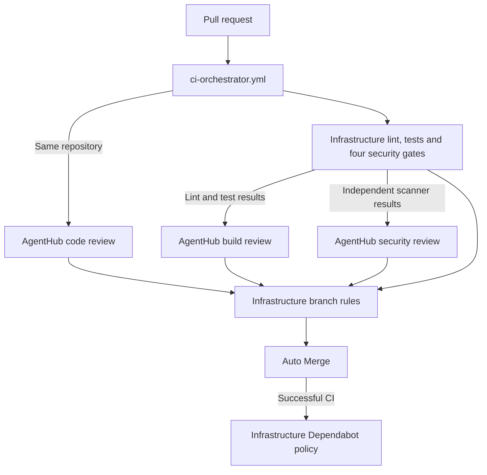
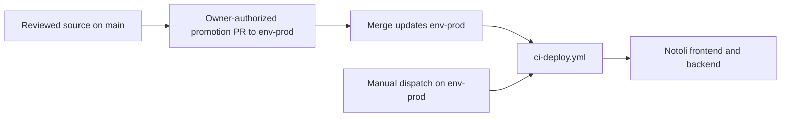

# GitHub workflows

## 🧭 Structure

| Local workflow | Trigger and responsibility |
| --- | --- |
| [ci-orchestrator.yml](ci-orchestrator.yml) | A pull request runs Infrastructure’s CI gates and the eligible AgentHub reviews. Each job declares its permissions and forwards only the secrets its reviewer uses. |
| [ci-auto-merge.yml](ci-auto-merge.yml) | CI completion starts Infrastructure’s Dependabot policy on the verified PR head. |
| [alert-codeql.yml](alert-codeql.yml) | At midnight Pacific, RoboCop updates tickets from open Code Scanning alerts while Infrastructure runs a full scan of `main`. Manual dispatch updates tickets by default. Select `scan_only` to run just the scan. |
| [alert-vulnerability.yml](alert-vulnerability.yml) | Daily at midnight Pacific or on manual dispatch, RoboCop reconciles Dependabot vulnerabilities. |
| [alert-malware.yml](alert-malware.yml) | Daily at midnight Pacific or on manual dispatch, RoboCop reconciles malware advisories. |
| [ci-deploy.yml](ci-deploy.yml) | Releases the owner-promoted `env-prod` revision or retries that release manually. |

Call reusable workflows on `main` in Infrastructure and AgentHub. Change the shared gates and merge policy in Infrastructure. Each alert calls AgentHub’s `triage-security.yml` with its feed. AgentHub owns the prompts, review publication and ticket handling. The application owns its tests, permissions, credentials and required checks. The app release workflow is generated from the Infrastructure release revision in `deploy/production/app.json`. [Infrastructure workflows](https://github.com/VanillaIceCube/infrastructure/tree/main/.github/workflows) · [AgentHub reviewers](https://github.com/VanillaIceCube/agent-hub#-reviewers-and-alert-triage)

### Main branch required checks

Frontend jobs read their Node range from `frontend/package.json`. The app publishes the named lint, test, CodeQL, dependency, secret and reviewer checks. `Auto Merge` reports the result of Infrastructure’s read-only check of branch rules and GitHub’s expected-head API. The separate `Dependabot Policy` follow-up owns auto-merge eligibility. For the configured required contexts and the read-only audit, see the repository’s [branch protection guide](../_README.md#-branch-protection). A failed path detector cannot excuse a skipped suite. Fork PRs run the independent gates without reviewer credentials. Applicable same-repository reviewers need a usable current-head verdict.

| Gate | Required contexts |
| --- | --- |
| Lint | `Lints / Detect Changes`, `Lints / Lint Frontend (ESLint + Prettier)`, `Lints / Lint Backend (Ruff)`, `Lints / Lint Results` |
| Tests | `Tests / Detect Changes`, `Tests / Frontend Tests (React)`, `Tests / Backend Tests (Django)`, `Tests / Test Results` |
| CodeQL | `CodeQL / Detect CodeQL Scope`, `CodeQL / Analyze Python`, `CodeQL / Analyze JavaScript/TypeScript`, `CodeQL / Analyze GitHub Actions` |
| Dependencies | `Vulnerability / Vulnerability`, `Malware / Malware` |
| AI reviewers | `AI Code Review / Obi-Wan Code-nobi code review`, `AI Build Sheriff Review / Lint Eastwood build sheriff review`, `AI Security Review / RoboCop security review` |

The read-only verifier accepts a ruleset and a current-head check-run response saved from GitHub. It verifies required evidence, including successful reviewers. Run the Infrastructure verifier with the two saved files as its arguments. Do not count a skipped, neutral or cancelled applicable reviewer as an approval.

### Protected Dependabot auto-merge

The trusted completion workflow resolves a successful CI run to its current PR head. It checks the applicable gates, three native approvals, workflow write permissions and dependency alerts before requesting native auto-merge with the expected head SHA. The policy matches skipped CodeQL checks by name and verifies their scope against the changed files. Major updates and SHA-only changes without a verified update type need owner review. [Repository settings](../_README.md)

## 🗺️ Architecture and trust boundaries



Forks run the independent gates. Trusted reviewers use their own GitHub App identity and OpenAI credentials in this repository. The scheduled alert callers use the same RoboCop identity and historical issue markers. [Credentials and branch protection](../_README.md)

### Production deployment



[Application release configuration and verification](../../deploy/production/README.md)

## 🧪 Checks and diagnostics

From the application root, use a sibling checkout of Infrastructure’s current `main` for the shared validators. Install its locked Node dependencies once.

```sh
npm ci --prefix ../JudeAndrewAlabaInfrastructure/.github --ignore-scripts --no-audit --no-fund
node ../JudeAndrewAlabaInfrastructure/.github/scripts/validate-workflows.js --audit
node --test ../JudeAndrewAlabaInfrastructure/.github/tests/integration/ci-orchestrator.test.js ../JudeAndrewAlabaInfrastructure/.github/tests/integration/uv-bootstrap.test.js
node ../JudeAndrewAlabaInfrastructure/.github/scripts/validate-repository.js
python deploy/production/build_bundle.py --check-parity
```

CI runs the app’s frontend tests and build, Django and MCP tests, conditional development image builds and release checks. The build reviewer receives bounded diagnostics from the jobs that actually ran.

## 🧪 Coverage boundaries

CodeQL analyzes the selected languages. Dependency Review and the malware gate check published advisories. Gitleaks checks for potential credentials. Live PR checks, review identities and alert dispatches require GitHub runner evidence. [Application configuration](../_README.md)
