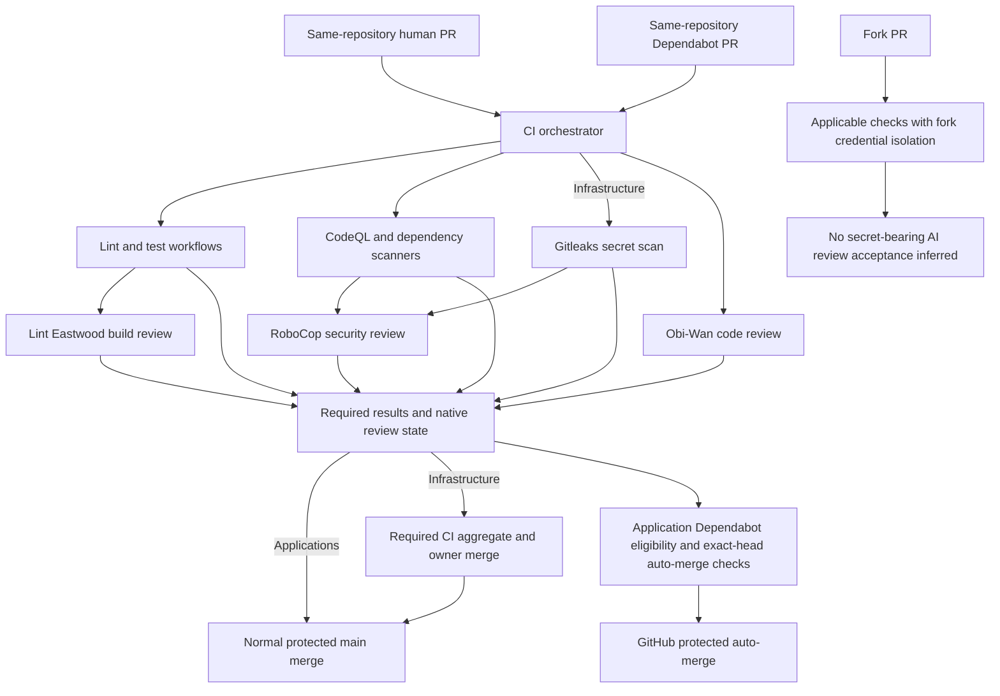
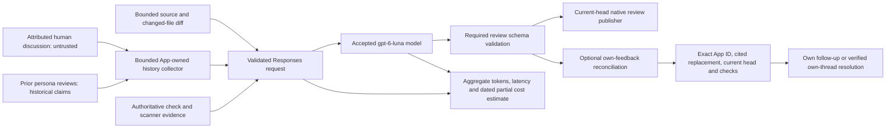
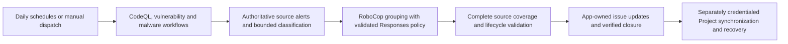
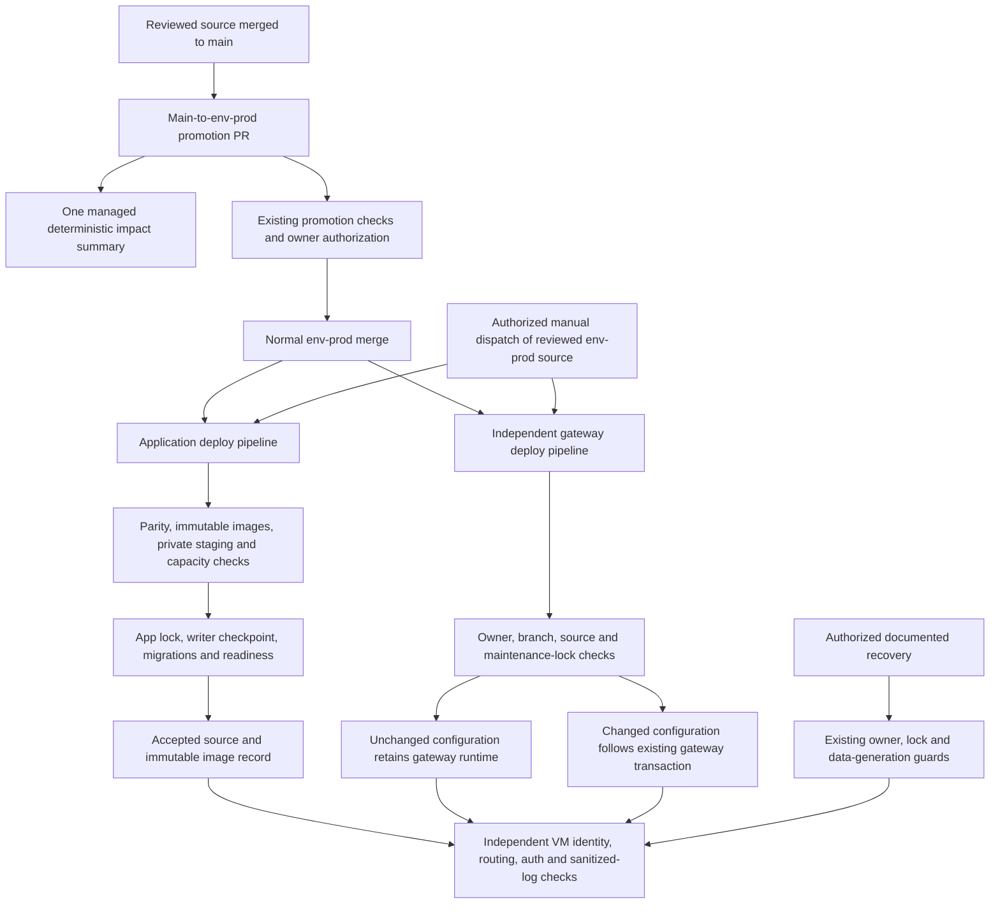

# CI/CD architecture and trust boundaries

This is the shared reference for the implementation after Batch 2 and Batch 3.
FullStackTemplate owns reusable application/reviewer patterns; Infrastructure owns
the gateway and versioned app release engine. The repository-specific
[workflow guide](../.github/README-WORKFLOWS.md) supplies configuration names and
operational details. Workflow YAML and protected-branch rules remain authoritative.
Historical Jules notes are history, not a future orchestration dependency; their
separately scoped cleanup is not part of this architecture.

## PR paths and required evidence

[`ci-orchestrator.yml`](../.github/workflows/ci-orchestrator.yml) accepts opened,
synchronized, reopened and ready-for-review PRs. Applications exclude `env-prod`;
Infrastructure restricts this orchestrator to `main` PRs. Same-repo
human and Dependabot PRs receive the three configured reviewers. Fork PRs do not
receive reviewer keys/App private keys; do not add `pull_request_target` or execute
a fork checkout with privileged credentials. A skipped reviewer is not evidence
of a successful live review. Required review acceptance must be established on an
appropriate reviewed same-repository head; retain the existing platform skip
policy and the stricter read-only reviewer gate audit when evaluating evidence.

Obi-Wan can start independently. Lint Eastwood consumes lint/test outcomes, while
RoboCop consumes CodeQL/dependency evidence and Infrastructure's secret scan.
Conditional path scopes remain explicit: analyzers may skip only under the
existing detector/baseline policy. Missing evidence, unavailable credentials,
invalid output and `REQUEST_CHANGES` remain failures. Native `APPROVE`/`COMMENT`
do not override another required check or authorize a deployment. Reviews bind
to the event head; old-head checks/reviews are not final-head acceptance.

App repositories retain their existing scoped Dependabot auto-merge helper and
protected GitHub auto-merge. It verifies event/author/repository, source/scope,
all required results and expected head without executing PR code in the privileged
`workflow_run` path. Infrastructure retains owner merge and its separate
`Required CI` aggregate, Gitleaks, offline Docker/Nginx validation and distinct
dependency-scope decision. It is not an application clone.

## Reviewer data and write boundary

The [reviewer contract](../.github/AI-REVIEWERS.md) defines exact byte/page/count
limits, API-specific bot identity, conservative single-line replacement proof,
serialized writers, permission diagnostics, configuration recovery and pricing
limitations. Discussion and tool output cannot override system policy, execute
commands, disclose secrets, suppress findings or authorize merges. Unavailable or
truncated context is disclosed. Human/other-bot threads are never resolved.
Broader, incomplete or ambiguous fixes stay open. Optional reconciliation does
not dismiss a blocking review or change required check results.

Each repository keeps the accepted Luna model and its own reviewer project.
Existing summaries/logs contain aggregate usage/configuration and request latency;
unknown usage/cost remains unknown. Estimated short-context Standard token costs
are dated and exclude unknown charges; they are not bills or a dollar budget.
Only the existing Dependabot major-upgrade code-review path enables web search.
No extra live model experiment or analytics platform is required.

## Credentials and privileged execution

| Role | Configuration names / scope | Boundary |
| --- | --- | --- |
| Reviewer OpenAI calls | `OBI_WAN_OPENAI_API_KEY`, `LINT_EASTWOOD_OPENAI_API_KEY`, `ROBOCOP_OPENAI_API_KEY`; `OPENAI_REVIEWERS_PROJECT_ID` | Separate persona keys and repository reviewer projects; never share with application environments |
| Native GitHub reviews | Persona App IDs and corresponding private-key secrets documented in the workflow guide | Repo-scoped short-lived installation tokens; verified bot identity; own-feedback writes only |
| Lint autofix | Existing Lint Eastwood App token | Same-repository human path only; Dependabot autofix and fork credentials remain excluded |
| Ordinary checks / summaries | `GITHUB_TOKEN`, explicit workflow/job permissions | Default repository token remains read-only; write grants are enumerated and reviewed before new consumers |
| Security-alert maintenance | RoboCop OpenAI/App credentials; `SECURITY_ALERTS_TOKEN`, `SECURITY_ALERTS_PROJECT_ID` | RoboCop reads source alerts/authors issue mutations; personal Project token is isolated to Project synchronization |
| App deployment | `DEPLOY_SSH_KEY`, app Django/email secrets, approved destination variables; GHCR token | Existing main-first pipeline, private release bundle and explicit per-app production policy |
| MacroMapper application AI | `MACROMAPPER_OPENAI_API_KEY`, app-selected model/timeout | Private/local and production/public-facing project/key separation remains application-owned; reviewer changes never consolidate them |
| Gateway deployment | `DEPLOY_SSH_KEY`, gateway owner/branch/source/destination/fingerprint variables | Credential-free authorization precedes key loading; independent gateway controls and host lock remain |

The exact names, installation permissions and Actions/Dependabot provisioning
are in [the workflow guide](../.github/README-WORKFLOWS.md). Reviewer OpenAI keys
and App private keys required by Dependabot are provisioned in both secret stores;
production/Project secrets are not added to Dependabot. Source-linked guides list
names, never secret values. Repository Actions secrets are not branch-scoped:
arbitrary same-repository workflow writers are privileged. Helper checks do not
constrain another workflow or a host administrator. No shared reviewer project,
new account, key rotation or broader credential is introduced.

External Actions remain immutable SHA-pinned. The parsed-YAML permission policy
uses the platform-selected base policy: a proposed workflow cannot grant itself
new write access. A new grant merges through review before its consumer workflow.

## Scheduled source-alert maintenance

The [`alert-codeql`](../.github/workflows/alert-codeql.yml),
[`alert-vulnerability`](../.github/workflows/alert-vulnerability.yml) and
[`alert-malware`](../.github/workflows/alert-malware.yml) workflows invoke the
shared security-alert action on their configured daily cron or manual dispatch.
Malformed/incomplete source/model evidence fails before unsafe lifecycle writes;
concurrent issue closure and Project recovery retain Batch1 safeguards. Scheduled
CodeQL analysis is separate from scheduled aggregation: CodeQL also analyzes
applicable main pushes, scoped PRs and manual runs. Alert maintenance does not
merge code or deploy. The deferred general Project-status project is not added.

## Promotion, release and manual operations

The [promotion-summary workflow](../.github/workflows/promotion-summary.yml)
loads reviewed `main` code, never the proposed PR checkout. A repository-wide
serialized writer refreshes every open `env-prod` PR (up to ten) on relevant PR,
target-branch push or manual events. It uses complete current GitHub file metadata
and identifies exact base/head revisions. Categories and counts are observations;
risks are explicitly inferences. No PR prose, patches, secret values or arbitrary
filenames are forwarded. Only the exact GitHub Actions bot's managed comment is
updated; reruns with the same comparison do nothing. Fork/protected tracking
items, incomplete inventories, moving revisions and uncertain/denied writes are
reported without claiming a maintained summary or changing authorization/gates.
The separate informational workflow can fail visibly without masking required CI.

Notoli and MacroMapper use their existing app-only release/recovery guide and
the Infrastructure-pinned shared source. Shared engine changes originate in
Infrastructure and are synchronized to consumers; do not edit vendor copies.
Each promotion must inspect the entire reviewed main-to-env-prod diff, retain
previous accepted recovery dependencies and reconcile GitHub evidence with fresh
independent VM observations. Public readiness is not authenticated/email delivery
acceptance. Never restore an older database over newer committed data or assume
universal migration rollback. Workflow/docs-only changes do not justify an
unnecessary app or gateway restart.

FullStackTemplate has no active production target in the verified baseline;
its workflow is an onboarding pattern, not permission to create `env-prod` or
new VM resources. Infrastructure's gateway release is distinct: owner/branch/
source authorization, secret scanning and Required CI remain, and unchanged
gateway identity avoids a restart. Application releases never recreate shared
networks/gateway or prune the host. Manual retries and recovery retain the
documented owner/operator authorization and data-generation barriers.

## Repository-specific sources

| Repository | CI / checks | Production procedure / intentional difference |
| --- | --- | --- |
| FullStackTemplate | [CI](https://github.com/VanillaIceCube/FullStackTemplate/blob/main/.github/workflows/ci-orchestrator.yml), [tests](https://github.com/VanillaIceCube/FullStackTemplate/blob/main/.github/workflows/gate-test.yml) | [Main-first policy](https://github.com/VanillaIceCube/FullStackTemplate/blob/main/docs/SHARED-ROLLOUT-POLICY.md); no active production target |
| Notoli | [CI](https://github.com/VanillaIceCube/Notoli/blob/main/.github/workflows/ci-orchestrator.yml), [tests](https://github.com/VanillaIceCube/Notoli/blob/main/.github/workflows/gate-test.yml) | [App release/recovery](https://github.com/VanillaIceCube/Notoli/blob/main/deploy/production/README.md); app-owned OAuth/tools and exact proxy trust |
| MacroMapper | [CI](https://github.com/VanillaIceCube/MacroMapper/blob/main/.github/workflows/ci-orchestrator.yml), [tests](https://github.com/VanillaIceCube/MacroMapper/blob/main/.github/workflows/gate-test.yml) | [App release/recovery](https://github.com/VanillaIceCube/MacroMapper/blob/main/deploy/production/README.md); app-owned AI credentials and OAuth/tools |
| Infrastructure | [Required CI](https://github.com/VanillaIceCube/JudeAndrewAlabaInfrastructure/blob/main/.github/workflows/ci-orchestrator.yml), [secret scan](https://github.com/VanillaIceCube/JudeAndrewAlabaInfrastructure/blob/main/.github/workflows/gate-secrets.yml), [validation](https://github.com/VanillaIceCube/JudeAndrewAlabaInfrastructure/blob/main/.github/workflows/validate.yml) | [Gateway releases](https://github.com/VanillaIceCube/JudeAndrewAlabaInfrastructure/blob/main/docs/gateway-releases.md), [shared app standard](https://github.com/VanillaIceCube/JudeAndrewAlabaInfrastructure/blob/main/docs/app-release-standard.md) |

## Shared custom actions and consumers

| Action/helper | Direct consumers | Applicability |
| --- | --- | --- |
| `get-pr-diff`, `collect-prior-ai-reviews`, `publish-ai-review` | Three reviewer workflows | All four repositories; persona ownership stays separate |
| `collect-upstream-major-upgrade-evidence` | Obi-Wan code reviewer | Same-repository Dependabot major upgrades |
| `openai-chat` | Three reviewers and `security-alerts` | Shared validated request/usage policy, repository-owned credentials |
| `collect-codeql-evidence` | RoboCop security reviewer | Scoped PR interpretation with actual default-branch baseline evidence |
| `prepare-vulnerability-report` | Vulnerability gate | Bounded report plus complete dependency artifact where applicable |
| `review-npm-malware` | Application malware gate | Changed exact npm versions; Infrastructure has a distinct no-app-graph scope gate |
| `security-alerts` | Three scheduled/manual alert workflows | Source coverage, issue lifecycle and separately credentialed Project recovery |
| `read-versions`, `prepare-lint-commit`, `dependabot-auto-merge` | Application lint/test/Dependabot paths | Application-specific; Infrastructure retains its independent checks and owner merge |
| `promotion-summary/summary.js` | Promotion-summary workflow | Shared deterministic metadata summarizer; distinct gateway recovery wording |

The generated per-repository source inventory is authoritative for actual local
Action references and direct consumers. Static validation/policy and test helpers
remain ordinary scripts under their existing gates; they are not new services.

## Keeping diagrams and consumers accurate

The sibling `CI-CD-SOURCE-INVENTORY.json` records this repository's actual workflow
events, jobs/needs, permissions, local custom-action consumers and credential names.
Regenerate/check it with `python scripts/ci_architecture.py --check` whenever YAML
changes. The checker parses YAML without executing workflows, verifies local
action references, validates the documented graph's core job/dependency/event
contracts and checks the diagrams' source contracts. Separately validate diagram syntax/rendering with
the official Mermaid parser/renderer when changing a diagram.
It does not read secrets or run deployments. GitHub-renderable Mermaid remains
ordinary source-controlled documentation, not a new reviewer-management service.

Cancelled rollback/catch-all/ruleset projects and deferred research, general
Project-status automation and Jules artifact cleanup remain outside this design.
